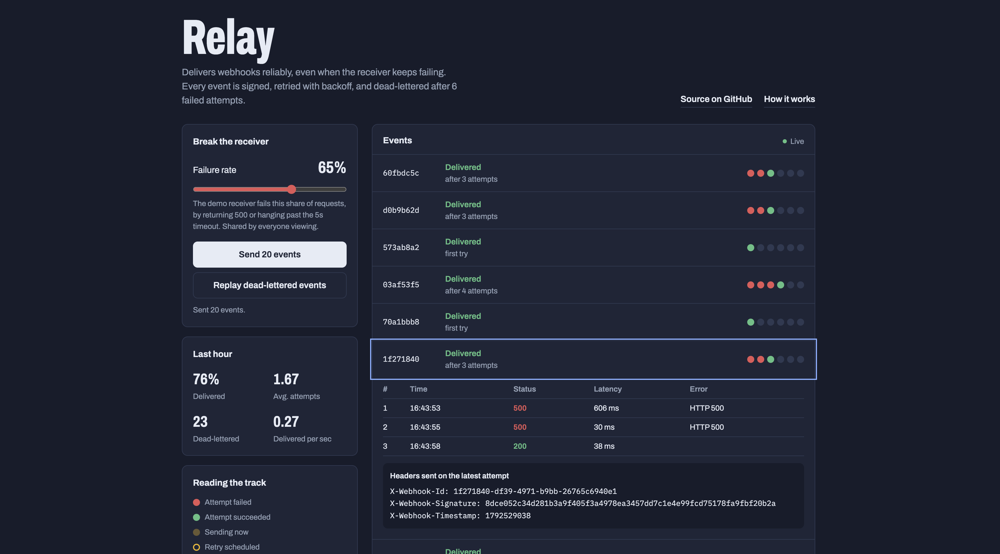
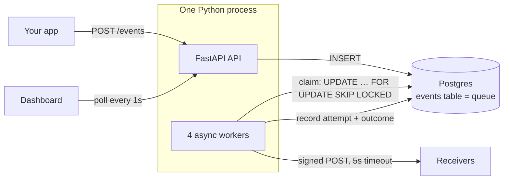
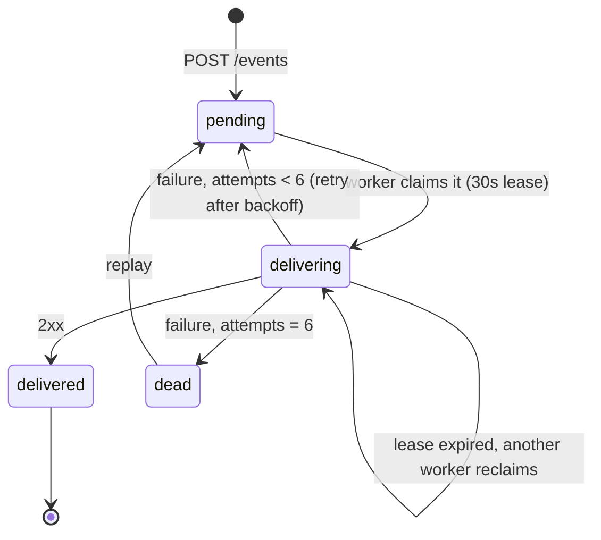

# Relay

[](https://github.com/anupvna/relay-webhooks/actions/workflows/ci.yml)

Relay is a webhook delivery service: it reliably delivers events (HTTP POSTs) from one system to another, even when the receiver keeps failing. Every event is signed with HMAC-SHA256, retried with exponential backoff and jitter, moved to a dead-letter queue after 6 failed attempts, and can be replayed. Every delivery attempt is logged. Postgres is both the database and the job queue — no Redis, no Kafka.

**Live demo: [relay-webhooks.onrender.com](https://relay-webhooks.onrender.com)** — drag the failure-rate slider up, send a batch, and watch events retry and recover. *(Free hosting: the first load can take ~1 minute while the server wakes up.)*



**Measured on a MacBook Air (single process, local Postgres):** 2,000 events against a receiver failing 30% of the time → 99.9% delivered, **0 duplicate deliveries**; raw throughput **380 events/sec**. [Full results](#load-test-results).

---

## Architecture



The API never talks to receivers. Submitting an event is a single `INSERT`, so the API stays fast no matter how slow receivers are. Workers pick events up within ~0.5s.

Each event moves through these states:



## How it works

### Claiming work safely: `FOR UPDATE SKIP LOCKED`

Four workers poll the same table. Each claims up to 10 due events in one statement:

```sql
UPDATE events e
SET status = 'delivering', locked_until = now() + interval '30 seconds'
FROM endpoints ep
WHERE ep.id = e.endpoint_id
  AND e.id IN (
      SELECT id FROM events
      WHERE (status = 'pending' AND next_attempt_at <= now())
         OR (status = 'delivering' AND locked_until < now())  -- crash recovery
      ORDER BY next_attempt_at
      FOR UPDATE SKIP LOCKED
      LIMIT 10
  )
RETURNING e.*, ep.url, ep.secret;
```

`FOR UPDATE` locks the rows a worker picks; `SKIP LOCKED` makes other workers **skip** those rows instead of waiting for them. Two workers can never claim the same event, and nobody blocks. The test suite proves this matters: with `SKIP LOCKED` removed, 300 events produced 480–560 deliveries across runs (hundreds of duplicates); with it, exactly 300.

### Leases and crash recovery

Claiming sets `locked_until` (a 30-second lease). If a worker crashes mid-delivery, the event stays `delivering` until the lease expires, then the second half of the `WHERE` clause lets another worker reclaim it. Nothing is lost, and no separate "reaper" process is needed.

When a worker writes its result, the `UPDATE` includes `AND locked_until = <the lease it was given>`. This is a **fencing check**: if a slow worker's lease expired and another worker took over, the stale write matches zero rows and is ignored instead of overwriting the newer result.

### Concurrency inside a worker

Each worker keeps up to 10 deliveries in flight and claims a replacement as soon as any one finishes. An earlier version claimed 10 and waited for all of them; one receiver hanging for the 5-second timeout stalled the other 9 (**head-of-line blocking**). Fixing that cut p50 delivery time under 30% failures from 92s to 12s (7.8× faster) in the load test.

### Retries: exponential backoff with jitter

```python
delay = min(CAP, BASE * 2**attempt) * random.uniform(0.5, 1.0)
```

- **Exponential**: each failure waits roughly twice as long, giving a struggling receiver room to recover instead of hammering it.
- **Jitter**: if a receiver goes down, hundreds of events fail in the same second. Without randomness they would all retry in the same second too (a *thundering herd*) and knock it over again.

The demo uses `BASE=1s`, `CAP=30s` so retries are watchable; both are environment variables.

### Dead-letter queue and replay

After 6 failed attempts an event becomes `dead` and workers ignore it. `POST /events/{id}/replay` (or `POST /dlq/replay` for all demo events) resets it to `pending` with a fresh retry budget, keeping its full attempt history. The replay `UPDATE` includes `WHERE status = 'dead'`, so the check and the change happen atomically: two simultaneous replays can't both succeed, and a delivered event can never be resent by accident.

### Signing (HMAC-SHA256)

Every request carries:

| Header | Value |
|---|---|
| `X-Webhook-Id` | event id (also the de-duplication key) |
| `X-Webhook-Timestamp` | unix seconds when sent |
| `X-Webhook-Signature` | hex `HMAC-SHA256(secret, "{id}.{timestamp}.{raw_body}")` |

The **body** is covered so any tampering breaks the signature; the **id** binds it to one event; the **timestamp** lets receivers reject anything older than 5 minutes, so a captured request can't be replayed later. Relay serializes the JSON once and signs those exact bytes, because re-serializing could reorder keys and break verification.

## Verifying a webhook (for receivers)

```python
import hashlib, hmac, time

def verify(secret: str, headers: dict, raw_body: bytes, tolerance: int = 300) -> bool:
    event_id = headers["X-Webhook-Id"]
    timestamp = headers["X-Webhook-Timestamp"]
    signature = headers["X-Webhook-Signature"]
    if abs(time.time() - int(timestamp)) > tolerance:
        return False  # too old (or from the future): possible replay
    message = f"{event_id}.{timestamp}.".encode() + raw_body
    expected = hmac.new(secret.encode(), message, hashlib.sha256).hexdigest()
    return hmac.compare_digest(expected, signature)  # constant-time compare
```

Use the **raw** request body, not re-serialized JSON. Then de-duplicate on `X-Webhook-Id` (see below). The built-in demo receiver runs exactly this check and returns `401` on a bad signature.

## Design decisions and trade-offs

**Postgres instead of Redis or Kafka.** The events table *is* the queue. One system to run, and enqueuing an event can share a transaction with the business data that caused it, so you never get "order saved but webhook lost". `SKIP LOCKED` makes it a correct multi-consumer queue. The cost is throughput: every claim and result is a database write, so this tops out far below a dedicated broker. For thousands of events per second that's the right trade; for millions it isn't.

**At-least-once, not exactly-once.** If a worker crashes after the receiver got the webhook but before the result is saved, the lease expires and the event is sent again. Exactly-once delivery over HTTP to a system you don't control isn't achievable — the network can always fail between "receiver processed it" and "sender learned that". So Relay guarantees at-least-once, and receivers de-duplicate on `X-Webhook-Id` (store processed ids, ignore repeats). Within Relay itself, the load test counts duplicates at the receiver: 0.

**No ordering guarantee.** Events are claimed roughly in `next_attempt_at` order, but they're delivered concurrently and retried independently: if event A fails and B succeeds, B arrives first. Strict ordering would mean delivering one event at a time per receiver and blocking everything behind a single failure, which is exactly the outage amplification this service exists to avoid. Receivers that care about order should use timestamps or version numbers in the payload.

**Workers run inside the API process.** One service to host for free. They coordinate only through Postgres, so moving them to separate processes or machines needs no code change.

**Free-tier hosting fits the design.** The host sleeps after 15 minutes without traffic, and the database scales to zero after 5 minutes idle. An always-on host would keep the workers polling the database every 0.5s all month and exceed the free database compute quota.

## Scaling it further

Roughly in the order I'd do them:

1. **More workers and processes.** The claim query already supports any number of consumers; run more processes, or move workers to their own service. The load test shows a single process is CPU-bound (~95% of one core while acting as both sender and receiver).
2. **Reduce database round-trips.** Batch the result writes, use `LISTEN/NOTIFY` to wake workers instantly instead of polling, and partition the events table by time so cleanup is a cheap `DROP PARTITION`.
3. **Per-receiver fairness.** Today one slow receiver can occupy many slots. Add per-endpoint concurrency limits and a circuit breaker that pauses deliveries to an endpoint that keeps failing.
4. **A real broker at very high volume** (e.g. ~10k+ events/sec sustained): Kafka or SQS for the queue, keeping Postgres for the attempt log and replay.

## Load test results

[`scripts/load_test.py`](scripts/load_test.py) inserts N events for the demo receiver at once, waits until every one is delivered or dead-lettered, and reports what happened. Duplicates are counted **by the receiver**, not by Relay. Measured on a MacBook Air (Apple Silicon), one process with 4 workers, Postgres 16 in Docker:

| Metric | 30% receiver failures | 0% failures (raw throughput) |
|---|---|---|
| Events | 2,000 | 5,000 |
| Eventually delivered | 1,998 (99.90%) | 5,000 (100.00%) |
| Dead-lettered (6 failed attempts) | 2 (0.10%) | 0 |
| Avg attempts per delivered event | 1.44 | 1.00 |
| Total HTTP attempts | 2,889 | 5,000 |
| p50 end-to-end delivery time | 11.76s | 7.00s |
| p95 end-to-end delivery time | 24.81s | 12.63s |
| Throughput | 26.4 events/sec | 379.9 events/sec |
| Duplicate deliveries | **0** | **0** |

**Before vs after the head-of-line blocking fix** (same machine, same test: 2,000 events, 30% failures):

| | Batch-and-wait workers | Continuous in-flight workers |
|---|---|---|
| p50 end-to-end delivery time | 91.69s | 11.76s (7.8× faster) |
| p95 end-to-end delivery time | 172.49s | 24.81s (7.0× faster) |
| Throughput | 9.2 events/sec | 26.4 events/sec |
| Delivered / duplicates | 99.90% / 0 | 99.90% / 0 |

How to read this:
- **Dead-lettered 0.10%** matches the theory: an event dies only if 6 attempts in a row fail, 0.3⁶ ≈ 0.07%.
- **Under failures, time is dominated by deliberate backoff waits**, not processing: an event that fails 4 times waits up to 2 + 4 + 8 + 16 seconds between attempts, by design. That's why throughput is lower in that column.
- **Latency in the 0% column is queueing**: all 5,000 events were inserted in the same instant and fully drained in about 14 seconds.

Run it yourself:

```bash
ADMIN_API_KEY=dev-key uvicorn app.main:app --no-access-log      # terminal 1
ADMIN_API_KEY=dev-key python scripts/load_test.py --events 2000  # terminal 2
ADMIN_API_KEY=dev-key python scripts/load_test.py --events 5000 --failure-rate 0
```

## Running locally

Requires Python 3.12+ and Docker.

```bash
git clone https://github.com/anupvna/relay-webhooks.git
cd relay-webhooks
python3 -m venv .venv && source .venv/bin/activate
pip install -r requirements.txt

docker compose up -d db                              # Postgres 16 on port 5433
ADMIN_API_KEY=dev-key uvicorn app.main:app --reload  # http://localhost:8000
```

Migrations run automatically on startup. API docs are at `/docs`. Or run everything in containers with `docker compose up --build`.

### Tests

```bash
pytest -v
```

41 tests, about 1 second. They use a separate `relay_test` database (created automatically) and fake receivers built on `httpx.MockTransport`: the worker sends real signed requests, answered by a scripted Python function instead of the network. Covered:

- **Unit**: backoff stays within its bounds, grows, respects the cap, and is actually random; signatures pass when valid and fail on a tampered body, wrong secret, changed id, old or future timestamp, or garbage input.
- **Integration (real Postgres)**: pending → delivered; fails twice then succeeds (3 attempts logged); timeouts and connection errors count as failures; dead-lettered after exactly 6 attempts, then replayed and delivered.
- **Concurrency**: 8 workers race over 300 events, and separately the production worker loop runs with failures and retries — every event delivered exactly once.
- **Crash recovery and fencing**: an expired lease is reclaimed, a live lease is not, and a stale worker can't overwrite a newer result.
- **API**: admin key enforcement, private events hidden from the public, replay rules, stats, signature rejection, rate limiting.

CI runs the whole suite against a Postgres 16 service container on every push.

## API

| Method | Path | Notes |
|---|---|---|
| `POST` | `/endpoints` | Register a receiver URL; returns its id and signing secret. Admin key required. |
| `POST` | `/events` | Queue `{endpoint_id, type, payload}`. Admin key required. |
| `GET` | `/events?status=` | Recent events (public callers see demo events only). |
| `GET` | `/events/{id}` | One event with its full attempt history and sent headers. |
| `POST` | `/events/{id}/replay` | Reset a dead event to pending. |
| `POST` | `/dlq/replay` | Replay all dead demo events. |
| `GET` | `/stats` | Delivered %, avg attempts, dead count, events/sec. |
| `GET` | `/health` | Also checks the database. |
| `POST` | `/demo/receiver` | Built-in flaky receiver; verifies signatures. |
| `PUT` | `/demo/failure-rate` | Set the receiver's failure rate (0–1). Rate-limited. |
| `POST` | `/demo/send-batch` | Queue up to 50 demo events. Rate-limited to 6/min per IP. |

Admin calls send `X-API-Key: <ADMIN_API_KEY>`.

## Public demo safety

The dashboard can only send to the built-in demo receiver, so visitors can't make the server POST to arbitrary URLs. Registering endpoints and submitting events require the admin key (compared in constant time). Demo actions are rate-limited per IP and capped at 50 events per batch, and demo events are deleted after an hour so the free database never fills up.

## Project layout

```
app/
  main.py          startup: DB pool, migrations, workers, cleanup task
  worker.py        claim → deliver → record → retry / dead-letter
  signing.py       HMAC sign and verify
  backoff.py       exponential backoff with jitter
  db.py            connection pool and migration runner
  routes/          endpoints, events, stats, demo
  static/index.html  dashboard (vanilla JS, no build step)
migrations/        plain SQL, applied in order
tests/             41 tests
scripts/load_test.py
```
